 

## 🖤 About me

I like making things work, and then making them work better. I move between scripting, systems and the web depending on what the project needs, mostly late at night with the lights off.

## 🥀 Languages & tools

  

## 📊 GitHub stats

 

